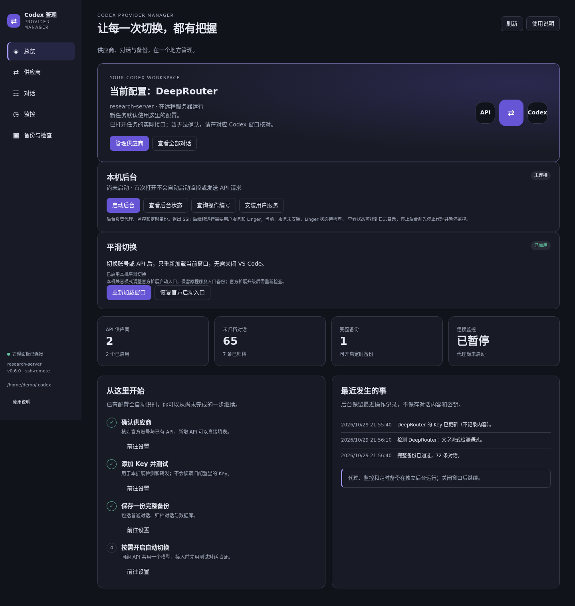

# Codex Provider Manager

在 VS Code 中管理 Codex 的官方账号、第三方 API、对话、监控和备份。支持 Remote SSH：连接服务器后，管理的是服务器上的 Codex。

**当前版本：0.6.0 预发布版，已发布到 GitHub。** 本项目独立开发，与 OpenAI 无隶属关系；GitHub 发布不代表已上架 VS Code Marketplace。

[下载安装包](https://github.com/yfdskr/codex-provider-session-guide/releases/tag/v0.6.0) · [安装与使用](docs/安装与使用.md) · [常见问题](docs/常见问题.md) · [开发说明](CONTRIBUTING.md) · [完整验证记录](docs/发布与验证.md)



截图来自 0.6.0 的浏览器测试，账号、对话和供应商状态均为演示数据，不代表实时机器状态。

## 能做什么

| 功能 | 当前能力 |
| --- | --- |
| 多个官方账号 | 独立登录、保存、查看身份；选择后切换 |
| 第三方 API | 新增、编辑、隐藏输入 Key，分别检查配置、文字流式和工具格式 |
| 平滑切换 | 首次启用兼容模式后，确认任务结束，切换并重新加载当前窗口 |
| 对话目录 | 搜索、项目筛选、排序、分页、多选、归档、取消归档和删除 |
| API 备用接口 | 同组、相同模型，通过本机 Responses 代理按规则尝试备用接口 |
| 定时监控 | 自定检查间隔、生效时间与时区；默认北京时间 |
| 完整备份 | 普通与归档对话、数据库、一致性检查、定时备份和逐文件校验 |
| 独立后台 | Linux 用户服务；关闭或重载编辑器后按设置继续运行 |

## 五分钟开始

1. 从 [Releases](https://github.com/yfdskr/codex-provider-session-guide/releases) 下载 `codex-provider-manager-0.6.0.vsix`。
2. VS Code 扩展页右上角 `…` → **从 VSIX 安装**。Remote SSH 用户安装到目标服务器端。
3. 等当前任务结束，运行 **开发人员：重新加载窗口**。
4. 按 `Ctrl+Shift+P`，运行 **Codex 管理：打开可视化管理中心**，核对机器、Codex 目录和版本。
5. 按 [安装与使用](docs/安装与使用.md) 安装必要依赖、保存账号或添加 API；先检查配置，再用测试对话验收。

启用平滑切换前须检查下表，不兼容时不要强行修改版本号。

## 运行条件与已知限制

| 项目 | 要求或限制 |
| --- | --- |
| VS Code | 1.95.0 或以上；安装官方 Codex 扩展，工作区已信任 |
| 已验证平台 | Linux x64；Windows、macOS 后台与平滑切换尚未验收 |
| 平滑切换 | 仅适配官方扩展 `26.51007.21434` 的已知原程序哈希；其他版本阻止启用 |
| 运行依赖 | Node.js 20+、Python 3.10+；开发推荐 Node.js 24 |
| 会话供应商同步 | 切换需要额外安装 `@dailin521/codex-provider-sync`，可执行命令为 `codex-provider` |
| API 协议 | 当前代理只支持 Responses 流式接口；不能把 Chat Completions 或旧 Completions 地址直接改名接入 |
| 多窗口 | 不能确认其他窗口的全部任务；切换需任务结束，其他 Codex 仍在线时等待，不强杀进程 |
| 多机器 | 当前管理扩展所在机器；统一网页、微信/钉钉与跨服务器对话迁移尚未实现 |

平滑切换会在你确认后调整本机官方扩展启动入口，完整保留原程序及恢复副本，不修改官方清单和全局设置。官方升级后需重新核对兼容性。**卸载管理器前，先在总览点击“恢复官方启动入口”，然后重新加载窗口。**

## 对话、费用与数据

- 切换先备份，再同步供应商标记、应用选定账号并核对对话 ID 与正文。结果未知时不自动重跑，也不用旧快照覆盖新消息。
- 归档、取消归档、删除前展示已知父子会话影响并备份。删除当前记录不会清除旧备份。尚不提供一键覆盖恢复。
- 密钥与登录缓存保存在本机受限目录，**没有额外静态加密**，不应同步到公开仓库。诊断不包含 Key 和对话正文。
- 配置检查不发模型请求；连接、工具格式测试和周期监控可能收费。代理实际请求会发送到所选供应商。
- “当前配置”不证明已打开的所有窗口都在使用新接口。历史对话不等于实时任务，独立读取进程不能接管任意官方窗口。

详见 [数据与安全](SECURITY.md)。

## 文档入口

| 想做什么 | 文档 |
| --- | --- |
| 安装、账号/API、归档、监控和备份 | [安装与使用](docs/安装与使用.md) |
| 官方账号与 API 切换的具体步骤 | [账号与接口操作](docs/账号与接口操作.md) |
| 后台常驻、退出 SSH 与服务排错 | [后台使用与验收](docs/后台验收.md) |
| 常见错误、恢复入口、让 GPT 协助 | [常见问题](docs/常见问题.md) |
| 不安装管理器，手动切换供应商 | [通用方法：以 DeepRouter 为例](public/docs/通用方法.md) |
| 架构、开发、打包和测试 | [开发说明](CONTRIBUTING.md)、[重载切换实现](docs/重载切换开发.md) |
| 已验证什么、还有什么待验证 | [发布与验证](docs/发布与验证.md) |
| 后续开发顺序 | [开发计划](开发计划.md) |
| 历史版本变化 | [更新记录](extension/CHANGELOG.md) |

## 从源码构建

```bash
git clone https://github.com/yfdskr/codex-provider-session-guide.git
cd codex-provider-session-guide/extension
npm ci
npm run check
npm test
npx playwright install --with-deps chromium
npm run test:ui
npm run package
```

安装包生成在 `extension/artifacts/`。`agent/`、`core/` 与 `extension/` 必须一同保留，不能只复制扩展子目录构建。默认测试不读取真实登录；可选的真实进程测试需要显式设置程序路径，详见 [开发说明](CONTRIBUTING.md)。

## 当前验证状态

0.6.0 原发布基线通过 79 项自动测试、13 项浏览器测试及隔离的真实 VS Code 生命周期测试。用户确认本机平滑切换与官方账号切换成功。真实 **官方 → API → 官方** 往返按用户要求暂缓，不能视为已通过；后续操作说明也不等于已完成验收。此次公开发布前的重新检查见 [发布与验证](docs/发布与验证.md)。

## 后续方向与许可证

先完善扩展端体验和兼容性，再做独立多机器网页与手机入口，最后接消息通知。跨服务器对话迁移已记录需求，暂不开发实时双向同步。

源码按 [MIT](LICENSE) 发布。内置依赖许可见 [第三方声明](extension/THIRD_PARTY_NOTICES.md)。仓库不附带官方 Codex 程序或账号；外部同步工具与其他参考项目使用各自许可证。
