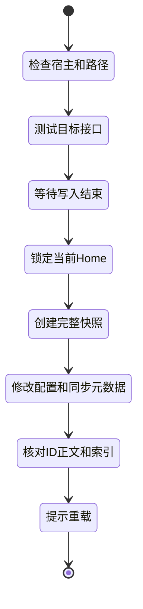

# VS Code 可视化供应商与会话管理扩展

状态：2026-10-29，`0.6.0` 作为 GitHub 预发布版交付，未上架 Marketplace。已有五页管理中心、独立后台、多官方账号、分项检查、对话整理与备份；新增可撤销的本机平滑切换，首次启用后只重载当前窗口。当前支持已适配的 Linux x64 官方扩展版本，升级需重新检查。隔离的真实 VS Code 已验证启用、重载切换、对话保留和撤销；真实账号组合继续验收。实时任务控制、直接跳转、覆盖恢复及 Chat Completions 转换暂未提供。

## 1. 是否值得做

可以做。核心是多供应商自动切换、可视化对话目录、用户自定义监控时间。三个功能组成一个管理面板；是否属于市场上独有的创新，还需对比现有产品。第一版使用独立侧栏与状态栏。

扩展名称为 `Codex Provider Manager`，标识 `yfdskr.codex-provider-manager`；与 Codex++、官方 Codex 区分。下文为设计说明，部分目标尚未实现，以仓库首页和当前使用文档为准。

## 2. 第一版界面

| 页面 / 区域 | 用户看到什么 | 操作 |
| --- | --- | --- |
| 状态栏 | 本机/SSH、当前供应商、模型、备份状态 | 打开管理面板 |
| 供应商 | 供应商分组、优先顺序、当前使用者、健康状态 | 新增、编辑、测试、手动选择、开启自动切换 |
| 兼容性 | 文字、流式、工具、图片、压缩、审批各自结果 | 使用虚构内容测试 |
| 会话 | 按项目列出对话标题、更新时间；分为进行中和已归档 | 搜索、打开、批量选择、归档、取消归档、删除 |
| 监控 | 检测间隔、超时时间、生效时段、失败次数、恢复等待时间 | 自定义、暂停、立即检查；显示下次检查时间 |
| 备份 | 时间、范围、数量、校验状态 | 创建、查看、受控恢复、设置保留份数 |
| 切换结果 | 目标、快照位置、是否完整、需重载 | 完成后重载；错误时显示具体处理步骤 |

切换界面展示清楚的操作范围。任务或多窗口仍在写入时等待或停止，不自动杀进程；恢复属于独立操作，不把“切回官方”实现为旧目录覆盖。

### 多供应商自动切换

像图中的“聚合供应商”，把 A、B 放进同一组，按优先级使用。A 连续失败后改用 B，面板说明切换原因、时间和目标。恢复后等待一段时间再检查，避免反复来回切换。

实现分两步：

1. **先做配置切换**：任务结束后备份、同步会话、切换配置并提示重载。适合官方账号与 API 之间切换，无法接管正在执行的请求。
2. **再做请求自动切换**：在 Codex 所在机器运行一个代理，Codex 固定连接它，由代理选择 A 或 B。这更接近图中的体验；同组 API 使用固定的供应商标记，逐次请求无需改写全部会话。

代理只向用户预先启用的供应商转发内容，提前说明对话可能发给哪些服务。官方账号继续走原有登录流程，不把官方登录凭证交给第三方代理。

首版代理只支持验证通过的 Responses 接口和模型组合。Chat Completions 需要另做转换，旧 Completions 不直接接入。超时、429、服务端故障可触发有限重试；401/403 提示修复凭证或权限，不反复重试。已经输出内容、发出工具调用或无法确定是否执行过的请求，暂停并提示用户，不能自动重放整轮任务。

### 可视化对话目录

“按项目分组”先作为视图，不搬动真实对话文件。打开操作需要验证官方扩展支持的入口；没有稳定入口时，显示会话 ID 和定位方法，不注入官方界面。

归档后从进行中列表移到已归档，取消归档后可继续。删除前展示选中的对话、可能涉及的子会话以及备份位置，确认后执行；删除当前记录不会自动删除历史备份中的副本。

优先使用官方 App Server 的列表、归档、取消归档和删除接口，并核对已安装版本是否支持。接口会更新文件与索引；不能只移动文件或只删数据库行。正在运行的会话先等待结束。官方接口可能连带处理子会话，完成后重新查询结果，逐项显示成功或失败。[官方接口说明](https://learn.chatgpt.com/docs/app-server)

### 用户自定义监控时间

把不同时间分开设置，避免一个“监控时间”含义不清。以下仅为可修改的设计默认值：

| 设置 | 示例 | 用途 |
| --- | --- | --- |
| 检测间隔 | 每 5 分钟 | 多久检查一次供应商 |
| 请求超时 | 30 秒 | 单次检测最多等多久 |
| 连续失败次数 | 3 次 | 失败几次才切换 |
| 恢复等待 | 5 分钟 | 故障供应商多久后重新检查 |
| 生效时段 | 全天，或 09:00–23:00 | 按界面明确显示的时区运行 |
| 备份计划 | 每天 04:00，保留 30 份 | 单独管理，不随健康检测重复备份 |

检测只发送虚构短内容，显示可能的费用；实际请求故障可提前触发检查。0.3.0 由同机独立后台监控，界面展示是否在线；退出 SSH 后继续需要 Linux 用户服务与 Linger，未确认时不保证常驻。已有服务器每日备份由 cron 执行，不依赖扩展窗口。

## 3. 切换流程



快照失败则不切换。写入后失败应显示“部分完成”、已修改范围和备份位置；不能虚报无改动，也不自动覆盖全部新消息。恢复前再次备份当前状态。

## 4. Remote SSH 是首要设计约束

扩展应在处理对应配置和会话的宿主执行文件操作：优先采用 workspace extension，在 SSH 窗口运行于服务器扩展宿主，并显示远程身份和绝对路径。`extensionKind`、远程窗口和扩展实际位置要实测，不能只看 VS Code 窗口标题。[VS Code Remote 扩展文档](https://code.visualstudio.com/api/advanced-topics/remote-extensions)

```text
Webview / 状态栏
    ↓ VS Code 消息通道
扩展宿主（本机或 SSH）
    ├─ 配置读写与密钥解析
    ├─ 接口能力测试
    ├─ 同步工具适配器
    └─ 完整备份、锁、日志和校验
```

远程代理也应运行在相应远程宿主。第一版不要求开放公网端口，也不依赖桌面 CDP。Web、Codespaces、容器和 WSL 的支持需逐项实现与验收，不自动宣称支持。

## 5. 密钥和权限

首选 VS Code SecretStorage 或平台凭证存储；配置仅保存引用。SecretStorage 不意味着独立启动的 Codex CLI 自动可取到令牌，需要设计并测试令牌解析通道。

Remote SSH 中必须确认凭证存储、解析器和 Codex 进程各在哪一端。若采用本地凭证向远程解析器传递，走受控的 VS Code 连接、短生命周期和可撤销授权；日志、Webview 状态、命令参数和仓库中均不包含明文 Key。不能默认 SecretStorage 在所有远程布局中都可直接共享。

Linux `600` 私有密钥文件可作为用户明确选择的兼容方式，界面说明存储位置和轮换方法。Windows/macOS 应采用对应平台方案。官方登录凭证与中转 Key 独立管理，不向中转站发送官方凭证。

工作区不受信任时只展示必要状态；网络测试、写配置、同步、清理和恢复需要受信任环境与清楚的操作范围。API 测试应提示使用虚构内容和可能的费用。

## 6. 实现模块与边界

| 模块 | 第一版职责 |
| --- | --- |
| RuntimeResolver | 找到运行宿主、Codex 可执行文件、Home、实际 SQLite 路径 |
| ProviderRegistry | 稳定供应商 ID、配置验证、认证引用、能力结果 |
| HealthMonitor / Router | 用户时间设置、失败计数、恢复等待、代理转发和切换记录 |
| CompatibilityProbe | 独立测试各项能力，不用供应商名称推断 |
| SessionAdapter | 优先适配固定版本同步工具，解析 JSON 完整/部分/失败状态 |
| ConversationManager | 分页列表、项目分组、归档与删除；适配当前版本官方接口 |
| BackupService | SQLite 在线快照、会话复制、清单、哈希、保留策略 |
| SwitchCoordinator | 每 Home 的跨进程锁、状态机、结果核对、重载 |
| CredentialResolver | 无回显录入、平台存储、供 CLI 使用的受控令牌解析 |
| ProtocolAdapter | 后续独立支持 Chat Completions；首版不伪装成全协议兼容 |

第三方工具调用使用参数数组，不拼接可执行 shell 字符串；固定版本、检查结果结构，发布时遵守上游许可证。客户端升级后重新测试配置字段、会话格式和索引布局。

可用 VS Code 的重载命令让新配置生效；若未来官方提供稳定的运行中切换接口，再按其合同实现。第一版不依赖未公开的 Codex 内部命令，不宣称能热切换正在执行的任务。

## 7. 开发顺序

1. 本机 Linux + Remote SSH：供应商分组、可视化对话列表、手动检测。
2. 完整备份、手动切换、归档与取消归档；删除需预览确认。
3. 自定义监控时间、自动选择备用 API、代理转发；先用模拟故障验证。
4. 后台运行、恢复、Windows/macOS 验收，再评估 Chat Completions 转换。

## 8. 发布前验收

| 场景 | 必须验证 |
| --- | --- |
| 官方 → API → 官方 | 原会话、API 新建会话、新增消息和上下文测试 |
| 两个 API 之间切换 | 不同 Key、不同模型及后端兼容边界 |
| 多会话、分页、归档 | ID 与正文不丢失，不把异常格式强行改写 |
| 归档 → 切换 → 取消归档 | 归档状态保持，恢复后能继续；原有与 API 新建对话都测 |
| 删除及子会话 | 预览范围与实际一致；备份中的副本是否保留有明确提示 |
| A 故障、B 正常、A 恢复 | 按设置切换和等待；不重复执行工具、不自动重放不确定的请求 |
| 自定义监控时间 | 检测次数、超时、时区、生效时段和下次检查时间正确 |
| 多窗口和并发写入 | 同 Home 锁有效；活动文件被跳过时不能显示全量成功 |
| 磁盘满、网络断、SQLite busy | 失败阶段准确，已有快照保留，恢复路径可执行 |
| 远程重连、退出编辑器 | 宿主选择正确，已配置的独立备份任务仍可运行 |
| 密钥与发布包 | 不进入日志、设置同步、Git 或 VSIX；平台存储实际可用 |

桌面版 Codex++ 和其他管理器可供交互设计参考，但不能据此声称本扩展已经完成、完全兼容，或解决跨后端加密推理问题。
